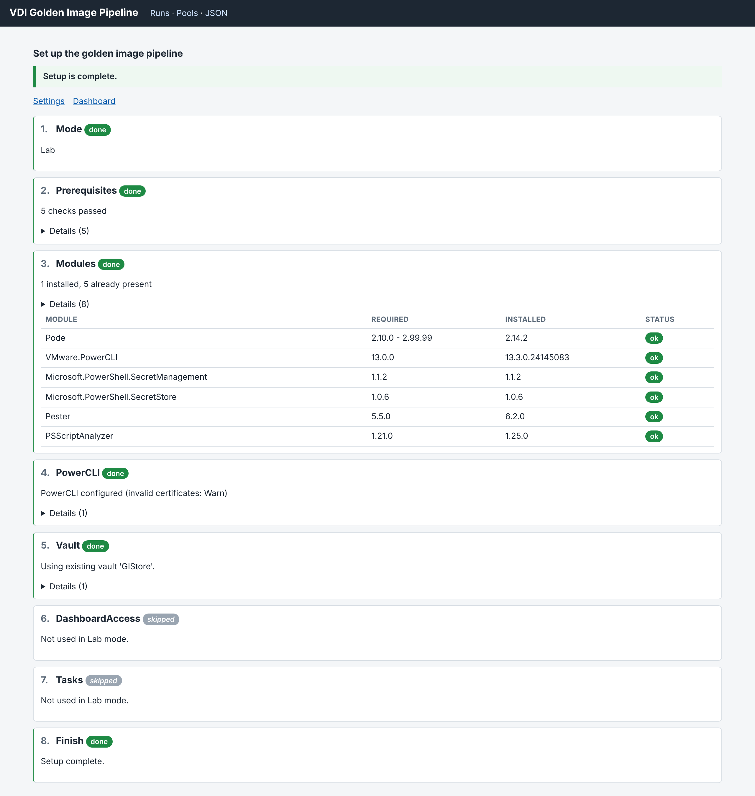
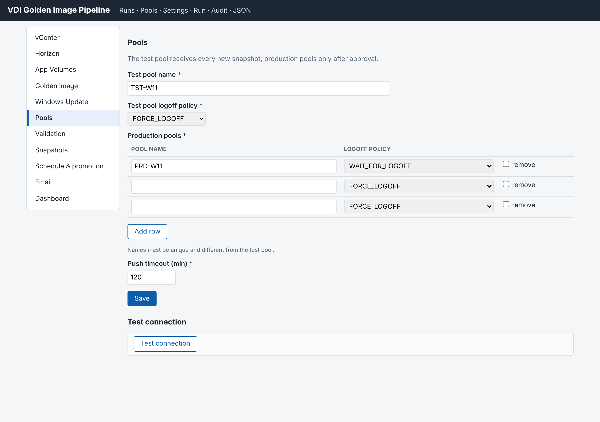
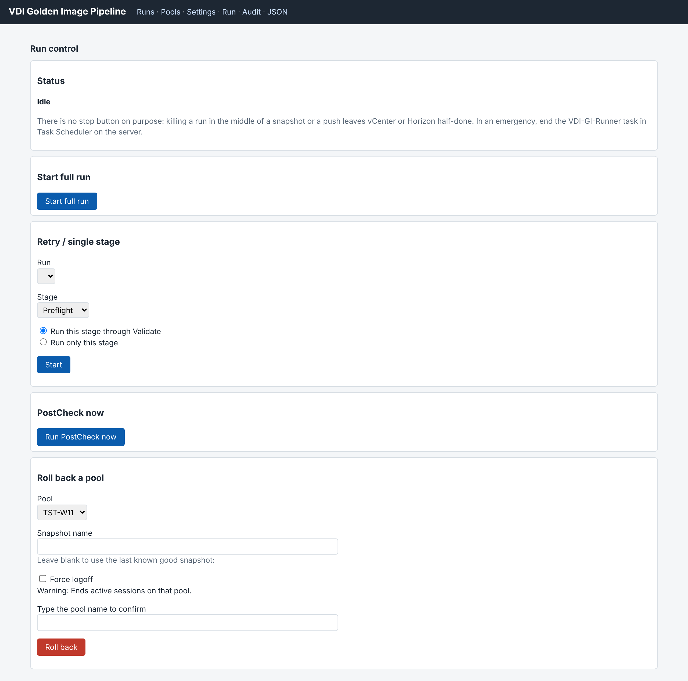

# Golden image maintenance pipeline

Runs the monthly golden image routine for Horizon instant-clone pools from a management server: patch the golden VM, snapshot it, test it on a test pool, wait for a human to approve, then push it to production in a maintenance window.

## Quick start

Clone the repository and run the launcher from the Pipeline folder:

```powershell
git clone --branch claude/practical-brown-xnoy5x https://github.com/Crolton1986/VDI-GoldenImage.git
cd VDI-GoldenImage\Pipeline

# Production: needs administrator rights, relaunches itself elevated if you aren't
.\Start-GIPipeline.ps1

# Lab or test machine: no admin, no scheduled tasks, 127.0.0.1 only
.\Start-GIPipeline.ps1 -LocalAdmin
```

You can start it from Windows PowerShell 5.1 or PowerShell 7. If PowerShell 7.2 or later isn't installed, the launcher asks before installing it (with winget, or the MSI from GitHub) and then continues in PowerShell 7. It installs the Pode module, which is the only module it needs before the web server can start. Then it starts the dashboard in setup mode and opens http://127.0.0.1:8080/setup in your browser. The setup page does the rest, one step at a time, with live progress.

Running from a OneDrive folder, or any path with spaces, works. For production, keep the pipeline in a fixed local folder such as `C:\ProgramData\VDI`, so the scheduled tasks don't depend on OneDrive Files On-Demand while you're logged off.


| Step | What it does | Lab | Production |
|---|---|---|---|
| Mode | You choose Lab or Production. With `-LocalAdmin` the choice is locked to Lab. | Yes | Yes |
| Prerequisites | Checks the OS, PowerShell version, admin rights, that powershellgallery.com is reachable, free disk space (2 GB), the execution policy, and scripts blocked as downloaded files. | Yes | Yes |
| Modules | Installs what's missing: Pode, VMware.PowerCLI, Microsoft.PowerShell.SecretManagement and Microsoft.PowerShell.SecretStore, plus Pester and PSScriptAnalyzer, which are optional. PowerCLI is large, so the first install takes several minutes. Modules go to AllUsers in Production and CurrentUser in Lab. | Yes | Yes |
| PowerCLI | Turns off the customer experience program and sets how PowerCLI treats invalid vCenter certificates. | Yes | Yes |
| Vault | Creates the SecretStore vault and sets it to open without a password for the Windows user running setup. | Yes | Yes |
| Dashboard access | Sets the https port, the certificate (pick one from the machine store or create a self-signed one) and the AD groups for viewers, approvers and admins. | Skipped | Yes |
| Tasks | Asks for your Windows password and registers the four scheduled tasks (listed under Manual setup, Scheduling). A Skip button leaves Task Scheduler untouched. | Skipped | Yes |
| Finish | Marks setup complete. | Yes | Yes |

A few things to know before you start:

* The Tasks step asks for your Windows password, because Task Scheduler needs it to run tasks when you're logged off. It's used once to register the tasks and isn't stored. The Skip button leaves Task Scheduler untouched, so you can register the tasks yourself later.
* The vault opens without a password for the user who runs setup, because the scheduled tasks have to read the secrets without anyone there to type one. Anyone who can log on as that user can read the secrets, so protect that account.
* Everything, including the vault, the tasks and the dashboard, runs as the user who ran setup.



After Finish, Production hands off to the `VDI-GI-Dashboard` scheduled task, which serves the dashboard over https, and the setup page stops itself a few seconds later. The launcher prints the dashboard address. In Lab mode the same page keeps running on 127.0.0.1, and you continue at `/settings` to enter your vCenter, Horizon and App Volumes details.

Launcher options:

| Option | Effect |
|---|---|
| `-ResetSetup` | Moves `config/setup.json` aside so setup runs again. |
| `-NoBrowser` | Doesn't open a browser. It prints the address instead. |
| `-Port` | Port for the setup page and for `-LocalAdmin` (default 8080). The production dashboard uses the port you pick in setup. |
| `-ConfigPath` | Uses a different config file. |

Setup progress is saved in `config/setup.json`, and each background step writes `config/setup-<Step>.transcript.log` (everything the step printed), `config/setup-<Step>.log` (its output) and `config/setup-<Step>.log.err` (its errors). Every step that has started has a View log link on the setup page that shows the end of these files, and a running step shows its latest lines inline. If a step fails, fix the cause and press Retry. Steps check what's already in place, so repeating one is safe.

## What it does

```
Preflight -> Maintain -> Snapshot -> TestPush -> Validate -> Approval -> Promote -> PostCheck
   |            |           |           |           |           |           |          |
 checks,     Windows     GI-<RunId>  push to     Horizon,    approve /   schedule   production
 safety      Update +    snapshot,   test pool   guest and   reject      pool       pools on
 snapshot    agents in   retention               App Volumes (dashboard  pushes     new image,
 pre-maint-* guest       report                  checks      or script)  per window last-known-good
```

1. Preflight checks that the golden VM is powered off, that every ticked package has an installer on the host (when an installer folder is set) and that no pool has a push pending, then takes a safety snapshot named `pre-maint-<RunId>`.
2. Maintain powers the VM on and runs Windows Update passes and `VDI-GoldenImage.ps1 -Unattended` actions inside the guest through VMware Tools, then runs the finalize action and waits for power off. It's split into sub-steps (revert failed run, safety snapshot, remove failed-run snapshots, power on, copy script, copy installers, enable updates, Windows Update, one step per package, reboot, read versions, finalize, power off), and the run page shows each one's status, start time, duration and latest message. Each package install has a timeout (Settings → Packages, `GoldenImage.ActionTimeoutMin`, default 60 minutes). When it runs out, the installer processes in the guest are stopped and the step fails, so a stuck installer can't block the run.
3. Snapshot creates `GI-<RunId>` with a manifest of the installed agent versions, then applies the retention policy.
4. TestPush pushes the snapshot to the test pool.
5. Validate checks Horizon (machine state), the guest (required services on a sample of machines) and App Volumes (test packages attached).
6. Approval waits for a person. With `Promotion.AutoPromote = $true` it approves itself when validation passes.
7. Promote schedules the push for each production pool at the approved start time.
8. PostCheck runs after the window. When every production pool is on the new image, the snapshot becomes the last-known-good.

If something is wrong after promotion, `-Stage Rollback` pushes the last-known-good snapshot to a pool.

Each run has a state file in `state/`, an HTML report in `reports/` and a log in `logs/`. The file formats are in `docs/CONTRACT.md`.

## Manual setup (without the launcher)

The launcher does all of this for you. Use these steps when you want to prepare the server yourself.

### Requirements

On the management server:

* Windows, PowerShell 7.2 or later
* VMware.PowerCLI
* Microsoft.PowerShell.SecretManagement and Microsoft.PowerShell.SecretStore
* Pode 2.x, for the dashboard
* Network access on 443 to vCenter, the Horizon Connection Server and the App Volumes Manager

```powershell
Install-Module VMware.PowerCLI, Microsoft.PowerShell.SecretManagement, Microsoft.PowerShell.SecretStore -Scope AllUsers
Install-Module Pode -MaximumVersion 2.99.99 -Scope AllUsers
```

The service account needs these permissions:

* vCenter: create and remove snapshots, power operations, and guest operations on the golden VM
* Horizon: an administrator role that can push images and read pools, machines and base images
* App Volumes: an administrator account with read access

The golden VM needs VMware Tools running and a local administrator account for the guest credential. The pipeline copies `VDI-GoldenImage.ps1` into the guest at `GoldenImage.ScriptPathInGuest` on every run, so you don't have to keep it there yourself. The guest script's own `.config` file lives next to it as described in the top-level README.

Installers for VMware Tools, Horizon Agent, DEM, App Volumes and Horizon Recording can't be downloaded automatically, so they have to reach the guest's `Install` folder somehow. Set the installer folder under Settings → Packages (`GoldenImage.InstallerSourceDir`) and drop the packages there; Maintain copies them into `Install` next to `ScriptPathInGuest` before the packages run. Files the guest already has with the same name and size are skipped, so a 300 MB Horizon Agent copies once, not every night. Leave it empty if you stage installers in the guest yourself. Keep only the version you want per product in the folder; the guest script picks the newest file matching each mask.

Settings → Packages lists every package the guest script knows. Tick the ones to maintain; they run in the order shown. Each row shows the installer the pipeline found in the host folder (file, version, size, date) and a status: Found, Downloads automatically (FSLogix, Teams, OneDrive and Google Drive are fetched by the guest script when missing), Missing, or Not checked when no folder is set. A ticked package that's Missing stops the run in Preflight, before the snapshot and before Windows Update.

The vault has to work without a prompt for the account that runs the scheduled tasks. The launcher sets this up for you. To do it by hand, sign in as that account once and run:

```powershell
Register-SecretVault -Name SecretStore -ModuleName Microsoft.PowerShell.SecretStore -DefaultVault
Set-SecretStoreConfiguration -Authentication None -Interaction None -Confirm:$false
```

A different SecretManagement vault works too, as long as it's readable by that account without interaction. The SecretStore vault is per user, so create the secrets as the service account as well. The dashboard can also set them (see Credentials under Dashboard).

### Secrets

The config file holds only secret names. Create these as the service account, or enter them in the dashboard:

```powershell
Set-Secret -Name GI-vCenter    -Secret (Get-Credential -Message 'vCenter')
Set-Secret -Name GI-Horizon    -Secret (Get-Credential -Message 'Horizon administrator')
Set-Secret -Name GI-AppVol     -Secret (Get-Credential -Message 'App Volumes administrator')
Set-Secret -Name GI-GuestAdmin -Secret (Get-Credential -Message 'Golden VM local administrator')
```

### Scheduling

`Register-GIPipelineTasks.ps1` creates four scheduled tasks. Run it from an elevated PowerShell 7 session. The setup page does this in its Tasks step.

```powershell
$cred = Get-Credential DOMAIN\svc-vdi-gi
.\Register-GIPipelineTasks.ps1 -Credential $cred -WhatIf
.\Register-GIPipelineTasks.ps1 -Credential $cred -PipelineDay Tuesday -PipelineTime 20:00
.\Register-GIPipelineTasks.ps1 -Credential $cred -ConfigPath D:\GI\prod.config.psd1
.\Register-GIPipelineTasks.ps1 -Unregister
```

| Task | Runs | When |
|---|---|---|
| VDI-GI-Pipeline | `Invoke-GIPipeline.ps1 -Stage All` | Weekly, Tuesday 20:00 by default |
| VDI-GI-PostCheck | `Invoke-GIPipeline.ps1 -Stage PostCheck` | Every hour |
| VDI-GI-Dashboard | `Web\Start-GIDashboard.ps1` | At startup, restarted up to 3 times, 1 minute apart |
| VDI-GI-Runner | `Invoke-GIPipeline.ps1 -FromRequest` | No trigger. The dashboard starts it when you queue a run |

The tasks run whether or not the account is logged on, with highest privileges. Running the script again updates the tasks in place. PostCheck exits with 3 while a push is still running, and the task history shows that as a failure. That's expected. The account needs the "Log on as a batch job" right.

The dashboard runs as the same account, and that account needs permission to start `VDI-GI-Runner` and to change the trigger of `VDI-GI-Pipeline`. If the dashboard reports that it couldn't start the runner or update the schedule, check the permissions on those tasks in Task Scheduler. `-Unregister` removes all four tasks.

## Configuration

`pipeline.config.psd1` holds the shipped defaults. You can edit it, or copy it and pass `-ConfigPath` to every script. Relative paths resolve against the Pipeline folder.

Changes made in the dashboard are saved to `config/settings.json`, which is layered over the psd1: only the keys you changed are stored, and where both files set a key, `settings.json` wins. If a psd1 edit seems to have no effect, check `settings.json` for the same key. The previous file is kept as `settings.json.bak`. Settings take effect on the next run. A run that's already going keeps the settings it started with.

| Section | Keys | Notes |
|---|---|---|
| Paths | State, Reports, Logs | Where run files go. |
| vCenter | Server, CredentialSecret | Used for snapshots, power operations and guest operations. |
| Horizon | Server, CredentialSecret, Domain, SkipCertificateCheck | Connection Server REST API. Leave the certificate check on in production. |
| AppVolumes | Server, CredentialSecret, SkipCertificateCheck, TestPackages, Endpoints | TestPackages are the packages assigned to the test pool's computers. Endpoints are the REST paths and differ between releases. |
| GoldenImage | VmName, GuestCredentialSecret, ScriptPathInGuest, InstallerSourceDir, Actions, WindowsUpdate, FinalizeAction, PowerOffTimeoutMin | Actions run in order with `-Unattended` after Windows Update; edit them and InstallerSourceDir under Settings → Packages, which saves them in catalog order. WindowsUpdate has Enabled and MaxPasses. |
| Pools | Test, Production, PushTimeoutMin | Test is one pool, Production is a list. Each pool has Name and LogoffPolicy (FORCE_LOGOFF or WAIT_FOR_LOGOFF). |
| Validation | GuestSampleCount, RequiredServices, MachineReadyTimeoutMin | Services are checked on that many test machines. |
| Snapshots | NamePrefix, Mode, Keep, MaxChainDepth, Prune, ProtectAncestors, ConsolidateTimeoutMin, MinFreeSpacePercent | Naming and retention. See Safety behavior. |
| Promotion | AutoPromote, MaintenanceWindow | MaintenanceWindow has Days and StartTime. The next matching window is used when you don't pass `-StartTime`. |
| Email | Enabled, SmtpServer, Port, From, To, UseSsl | Run report by mail. |
| Dashboard | Port, CertificateThumbprint, ViewerGroup, ApproverGroup, AdminGroup, RefreshSeconds | Web dashboard. Shown read-only in the dashboard. Edit the psd1 and restart it. |

## Running it

Run from the Pipeline folder on the management server.

```powershell
# Full run up to the approval gate
.\Invoke-GIPipeline.ps1 -Stage All

# Individual stages (newest run unless -RunId is given)
.\Invoke-GIPipeline.ps1 -Stage Preflight
.\Invoke-GIPipeline.ps1 -Stage Maintain  -RunId 20261124-213005
.\Invoke-GIPipeline.ps1 -Stage Snapshot  -RunId 20261124-213005
.\Invoke-GIPipeline.ps1 -Stage TestPush  -RunId 20261124-213005
.\Invoke-GIPipeline.ps1 -Stage Validate  -RunId 20261124-213005

# Recent runs
.\Invoke-GIPipeline.ps1 -Stage Status

# Check production after the window (safe to repeat)
.\Invoke-GIPipeline.ps1 -Stage PostCheck

# Continue an existing run from a stage, through Validate
.\Invoke-GIPipeline.ps1 -FromStage TestPush -RunId 20261124-213005

# Resume Maintain at a sub-step (SafetySnapshot restarts it), then continue through Validate
.\Invoke-GIPipeline.ps1 -FromStage Maintain -FromStep Pkg:Horizon -RunId 20261124-213005

# Run the request queued by the dashboard (what the VDI-GI-Runner task does)
.\Invoke-GIPipeline.ps1 -FromRequest
```

`-FromStage` accepts Preflight, Maintain, Snapshot, TestPush or Validate. It runs that stage and every stage after it up to Validate, and it needs `-RunId`.

Retrying Maintain after it failed or was interrupted resumes at the first unfinished sub-step. The safety snapshot, enabling updates, Windows Update and packages that already succeeded are skipped. Power on, the file copies and everything from the reboot onward always run again. `-FromStep <id>` (with `-FromStage Maintain` or `-Stage Maintain`) picks the step to resume from instead, and `-FromStep SafetySnapshot` restarts Maintain completely. If the golden VM was reverted to a snapshot since the earlier attempt started (the pipeline checks vCenter's events for a revert task), the earlier work is gone, so Maintain restarts from the beginning no matter what you asked for. When it can't read the events, it restarts as well, to be safe. After a revert to the run's own `pre-maint-<RunId>` snapshot, that snapshot is reused; after a revert to any other snapshot, a new `pre-maint-<RunId>-<time>` is taken.

A run that fails leaves the golden VM in whatever state it failed in, plus its `pre-maint-<RunId>` snapshot. When the next run's Maintain starts and the VM still sits on such a snapshot (the run is Failed, Rejected or RolledBack, or its run file is gone), Maintain first reverts to the oldest one in that chain, which is the state before the failed run touched the VM. Then it takes its own safety snapshot and removes the failed runs' `pre-maint` snapshots, oldest first, with disk consolidation after each. Nothing is removed while a push is pending or Horizon can't be reached, and a run's own snapshot or one still in use is never touched. Turn this off with Settings → Snapshots → Clean up after failed runs (`Snapshots.CleanupFailedRuns`); Maintain then only reports what it would revert and remove. Every invocation except `-Stage Status` takes the pipeline lock (`state/pipeline.lock`), so scheduled, command-line and dashboard runs never overlap.

Approval:

```powershell
# Next maintenance window from the config
.\Approve-GIPromotion.ps1 -RunId 20261124-213005

# A specific start time and a comment
.\Approve-GIPromotion.ps1 -RunId 20261124-213005 -StartTime '2026-11-28 22:00' -Comment 'CAB-1234'

# Reject
.\Approve-GIPromotion.ps1 -RunId 20261124-213005 -Reject -Comment 'Teams regression'

# See what would be scheduled without doing it
.\Approve-GIPromotion.ps1 -RunId 20261124-213005 -WhatIf
```

Rollback pushes the last-known-good snapshot, or a named one, to a pool:

```powershell
.\Invoke-GIPipeline.ps1 -Stage Rollback -PoolName PRD-W11
.\Invoke-GIPipeline.ps1 -Stage Rollback -PoolName PRD-W11 -SnapshotName GI-20261027-203000 -ForceLogoff
```

Exit codes for `Invoke-GIPipeline.ps1`:

| Code | Meaning |
|---|---|
| 0 | OK |
| 1 | A stage or the run failed |
| 3 | PostCheck isn't finished yet (a push is still running), or PostCheck found the pipeline busy. Try again later. |

## Dashboard

```powershell
.\Web\Start-GIDashboard.ps1
.\Web\Start-GIDashboard.ps1 -ConfigPath D:\GI\prod.config.psd1 -Port 9443
```

It serves https on `Dashboard.Port` using the certificate in the LocalMachine store whose thumbprint is in `Dashboard.CertificateThumbprint`. The service account needs read access to that certificate's private key. Find the thumbprint with:

```powershell
Get-ChildItem Cert:\LocalMachine\My | Select-Object Thumbprint, Subject, NotAfter
```

Users sign in with HTTP Basic over https, checked against Active Directory. There are three roles:

| Role | Group | Can do |
|---|---|---|
| Viewer | `Dashboard.ViewerGroup` | Look at runs, reports, logs and pools |
| Approver | `Dashboard.ApproverGroup` | Everything a viewer can, plus approve or reject |
| Admin | `Dashboard.AdminGroup` | Everything an approver can, plus settings, credentials, Test connection, run controls and the audit log |

Each role includes the ones above it. Forms carry a per-user token and the Origin header is checked, so another web page can't submit them.

### Settings



`/settings` has one sub-menu per system, with these sections: vCenter, Horizon, App Volumes, Golden image, Windows Update, Pools, Validation, Snapshots, Schedule & promotion, Email and Dashboard. Each section is a form with the fields, help text and validation for that part of the config.

* Saving writes the changed keys to `config/settings.json`, layered over `pipeline.config.psd1` (see Configuration). Changes apply from the next run.
* The Dashboard section is read-only here. Edit `pipeline.config.psd1` and restart the dashboard.
* Saving Schedule & promotion also updates the weekly trigger of the `VDI-GI-Pipeline` task, so the new day and time take effect without re-running `Register-GIPipelineTasks.ps1`.
* Turning on `AutoPromote` asks for a confirmation.

### Credentials

Sections that need a login (vCenter, Horizon, App Volumes, Golden image) show a username and password form. It's write-only: the password is never shown again. The credential is stored in the SecretManagement vault of the account the dashboard runs as, under the secret name from the config. That has to be the same account that runs the pipeline tasks, or the pipeline won't find the secret. `Register-GIPipelineTasks.ps1` already runs both as the account you give it. Leave the password blank to keep the stored one. Credential forms are only accepted over https, so `-NoTls` can't be used to enter them (the loopback-only `-LocalAdmin` lab mode is the exception).

### Test connection

Sections for vCenter, Horizon, App Volumes, Golden image, Pools and Email have a Test connection button. The checks are read-only. The Golden image test looks at the VM and its VMware Tools state and never powers it on.

Each test runs in its own PowerShell process with a 120-second limit, so a slow or stuck login can't freeze the dashboard. If the account is behind Duo or another MFA push, approve the push on your phone while the page loads; a denied or ignored push shows up as a failed test with an MFA hint. The pipeline's scheduled runs can't answer a push, so exempt the service account from MFA.

Dashboard errors and every request (including timeouts) are logged to `logs/dashboard_errors_*.log` and `logs/dashboard_requests_*.log`. Each test also writes `connection.test.start` and `connection.test` lines to the audit log.

### Run controls



`/run` (admin only) starts work without a shell on the server:

* Go starts a full run, the same as `-Stage All`.
* Retry from the failed stage continues an existing run from the stage that failed, through Validate. When Maintain failed, the run page offers Resume Maintain at the failed step, Restart Maintain from the beginning, and a picker to resume from any step.
* Single stage re-runs one of Preflight, Maintain, Snapshot, TestPush or Validate on an existing run.
* PostCheck now runs the production check straight away.
* Roll back a pool pushes the last-known-good snapshot, or one you name, to a pool. You have to type the pool name to confirm. Force logoff ends user sessions on the pool's machines.

How it works: the dashboard never runs a stage inside a web request. It writes `state/run-request.json` and starts the `VDI-GI-Runner` scheduled task, which runs `Invoke-GIPipeline.ps1 -FromRequest` as the service account. The runner takes `state/pipeline.lock` first. If the pipeline is busy (a scheduled run, a command-line run or another dashboard run), the request stays queued and an admin can cancel it on the Run page. Only one request can be queued at a time.

With `-LocalAdmin` (lab/test runs) there are no scheduled tasks. The dashboard starts `Invoke-GIPipeline.ps1 -FromRequest` as a hidden `pwsh` process under your own account instead, and its output goes to `logs/runner-<timestamp>.log`. To stop one in an emergency, end that `pwsh` process (its id is in the run's log), then check vCenter and Horizon as below.

There's no stop button. A stage can be partway through a snapshot, a guest operation or an image push, and killing the process from a web page would leave vCenter or Horizon in a state nobody has looked at. To stop in an emergency, end the `VDI-GI-Runner` task (or `VDI-GI-Pipeline` for a scheduled run) in Task Scheduler, then check vCenter and Horizon by hand: power state, snapshots, and any pending push on the pools. The stale lock clears itself on the next run once its process is gone.

### Audit

`/audit` (admin only) shows the newest 200 entries of `state/audit.jsonl`: settings saves with a field-level diff (secrets are never included), credential changes, connection tests, run requests and cancellations, approvals and rollbacks, each with the user and time.

### Lab mode

`-NoTls` serves plain http and `-NoAuth` skips sign-in. Use them for a lab only. With `-NoAuth` the dashboard is strictly read-only: the approve, reject, settings and run controls are disabled. `-NoAuth` also works on a non-Windows host.

`-LocalAdmin` is for lab and smoke tests. On first run, `Start-GIPipeline.ps1 -LocalAdmin` also goes through `/setup`, locked to Lab mode. It binds to 127.0.0.1 over plain http, with no sign-in, and treats everyone who reaches it as admin and approver. Never expose it: don't put it behind a reverse proxy, a port forward or a firewall rule, and don't use it on a server that real users can log on to.

### Routes

| Route | Purpose |
|---|---|
| `GET /` | Run list and last-known-good |
| `GET /runs/:runId` | Run detail with stages, checks and promotion status |
| `POST /runs/:runId/decision` | Approve or reject (approvers only) |
| `GET /reports/:runId` | HTML report |
| `GET /logs/:runId` | Run log |
| `GET /pools` | Pool status |
| `GET /settings`, `GET /settings/:section` | Settings sections (admins only) |
| `POST /settings/:section`, `/credential`, `/test` | Save, set credential, test connection (admins only) |
| `GET /run` | Run controls (admins only) |
| `POST /run/start`, `/run/rollback`, `/run/cancel-request` | Queue a run, queue a rollback, cancel a queued request (admins only) |
| `GET /audit` | Audit log (admins only) |
| `GET /api/runs` | Runs as JSON |
| `GET /api/runs/:runId` | One run as JSON |

## Safety behavior

* Preflight stops the run if the golden VM is powered on, if a ticked package has no installer in the host installer folder (when one is set), or if any configured pool already has a push pending. It then takes the `pre-maint-<RunId>` safety snapshot, so a bad update pass can be reverted.
* New snapshots are named `<Snapshots.NamePrefix> yy.MM.dd.HHmm` (default `Baseline 26.11.24.0131`).
* Retention runs after a production push passes PostCheck, never before. It's report-only until you set `Snapshots.Prune = $true`; the Snapshot stage message and the run report list what it would remove.
* In `Chain` mode (the default) the golden VM ends up as `Master > previous Baseline > production Baseline`. Older Baselines and the finished run's `pre-maint-*` snapshot are removed even though they sit under the production snapshot. vSphere merges a removed snapshot's changes into its child, so nothing in the image is lost. With `Keep = 2`, promoting `Baseline 26.11.24.0131` removes `Baseline 26.11.11.1340` and keeps `Baseline 26.11.20.1249` for rollback.
* Retention never removes the root snapshot, snapshots it doesn't manage (names other than `<prefix> *`, `GI-*`, `pre-maint-*`), any snapshot a pool uses or has a push pending for, or the last-known-good. If any push is pending, or Horizon can't be read, it removes nothing.
* Snapshots are removed one at a time, oldest first. After each one it checks `ConsolidationNeeded` and consolidates disks (timeout `Snapshots.ConsolidateTimeoutMin`), then re-reads Horizon to confirm every pool's image snapshot still resolves. If consolidation fails or a pool's snapshot stops resolving, it stops and reports an error. The report shows used space before and after, space freed, datastore free space and the remaining chain.
* The Snapshot stage also consolidates first if vCenter flags the VM, and fails if that doesn't work, so a new Baseline never stacks on an unconsolidated disk. It warns when a datastore is below `Snapshots.MinFreeSpacePercent` free.
* Horizon records the image by snapshot path, and removing a parent changes the path of its children. Test Chain mode in the lab first: promote, let retention remove the oldest Baseline, then confirm Resync and adding machines still work on the pool. `Tree` mode keeps the old behavior (never remove a parent of an in-use snapshot).
* When the snapshot chain gets deeper than `Snapshots.MaxChainDepth`, the report warns you. Plan a new golden image generation (a full clone of the VM) instead.
* Promotion schedules the pools one after another. If one fails, the pools already scheduled in that promotion are cancelled.
* `Promotion.AutoPromote` is `$false` by default, so a person has to approve every run.

## Confirm before first use

The Horizon and App Volumes calls were written from the documented APIs and haven't been run against your environment. Check these first.

Horizon REST paths used:

```
POST /rest/login            POST /rest/refresh          POST /rest/logout
GET  /inventory/v1/desktop-pools
GET  /inventory/v1/machines
GET  /config/v1/virtual-centers
GET  /external/v1/base-vms
GET  /external/v1/base-snapshots
POST /inventory/v1/desktop-pools/{id}/action/schedule-push-image
POST /inventory/v1/desktop-pools/{id}/action/cancel-scheduled-push-image
```

The pool fields read are listed in `Get-GIPoolImageInfo` in `src/Rest.ps1`: `provisioning_settings.parent_vm_id`, `provisioning_settings.base_snapshot_id`, and the `instant_clone_*` pending image and operation fields in `provisioning_status_data`. Compare all of it with `https://<connection-server>/rest/swagger-ui.html` for your Horizon version. A missing field reads as `$null`, which can make a push look finished or a pool look idle.

Other things to check:

* The App Volumes endpoints in `AppVolumes.Endpoints` are configurable and unverified. Compare them with your Manager's API documentation. The App Volumes check matches machine names in the response text, so a response that doesn't contain the machine name will fail the check.
* Windows Update runs through the Windows Update Agent COM API in a scheduled task running as SYSTEM inside the guest. If WSUS, SCCM or another tool manages updates, set `GoldenImage.WindowsUpdate.Enabled = $false` and patch with your own tool.

For the first rollout, run the stages one at a time against the lab pools with `Snapshots.Prune = $false`, read the report after each, and only then schedule the full run.

A suggested order for first-time setup:

1. Run `Start-GIPipeline.ps1`, or register the tasks with `Register-GIPipelineTasks.ps1`.
2. Start the dashboard (or let the VDI-GI-Dashboard task do it) and sign in as an admin.
3. Fill in each Settings section.
4. Set the credentials on the vCenter, Horizon, App Volumes and Golden image sections.
5. Run Test connection on every section that has one.
6. Press Go on the Run page against the lab pools, with `Snapshots.Prune` off.

## Tests

Pester 5 and PSScriptAnalyzer, from the repository root:

```powershell
Invoke-Pester -Path Pipeline/tests -Output Detailed
Invoke-ScriptAnalyzer -Path Pipeline -Recurse -Settings Pipeline/PSScriptAnalyzerSettings.psd1
```

The tests don't need vCenter, Horizon or Windows.
