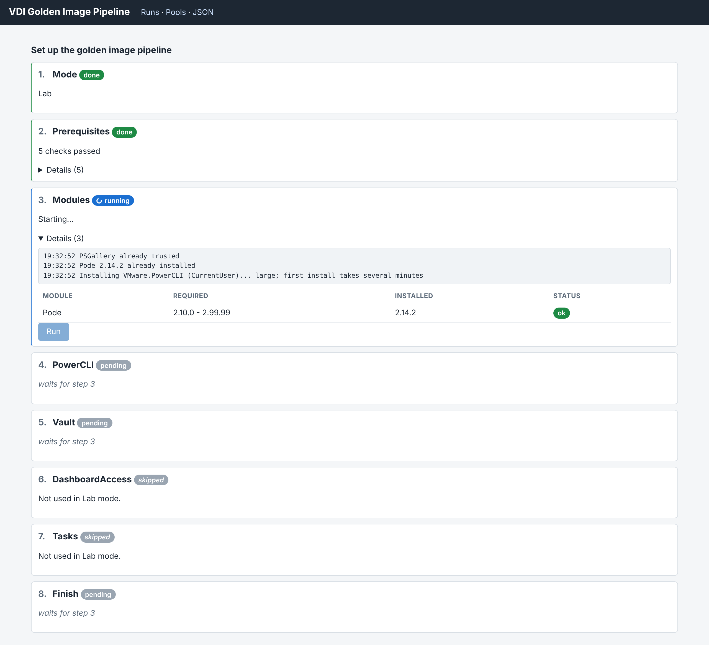

# Golden image maintenance pipeline

Runs the monthly golden image routine for Horizon instant-clone pools from a management server: patch the golden VM, snapshot it, test it on a test pool, wait for a human to approve, then push it to production in a maintenance window.

## Quick start

Clone the repository and run the launcher from the Pipeline folder:

```powershell
git clone --branch claude/practical-brown-xnoy5x https://github.com/Crolton1986/VDI-GoldenImage.git
cd VDI-GoldenImage\Pipeline

# Production: needs administrator rights, relaunches itself elevated if you aren't
.\Start-GIPipeline.ps1

# Lab or test machine: no admin, no scheduled tasks, 127.0.0.1 only
.\Start-GIPipeline.ps1 -LocalAdmin
```

You can start it from Windows PowerShell 5.1 or PowerShell 7. If PowerShell 7.2 or later isn't installed, the launcher asks before installing it (with winget, or the MSI from GitHub) and then continues in PowerShell 7. It installs the Pode module, which is the only module it needs before the web server can start. Then it starts the dashboard in setup mode and opens http://127.0.0.1:8080/setup in your browser. The setup page does the rest, one step at a time, with live progress.

Running from a OneDrive folder, or any path with spaces, works. For production, keep the pipeline in a fixed local folder such as `C:\ProgramData\VDI`, so the scheduled tasks don't depend on OneDrive Files On-Demand while you're logged off.



| Step | What it does | Lab | Production |
|---|---|---|---|
| Mode | You choose Lab or Production. With `-LocalAdmin` the choice is locked to Lab. | Yes | Yes |
| Prerequisites | Checks the OS, PowerShell version, admin rights, that powershellgallery.com is reachable, free disk space (2 GB), the execution policy, and scripts blocked as downloaded files. | Yes | Yes |
| Modules | Installs what's missing: Pode, VMware.PowerCLI, Microsoft.PowerShell.SecretManagement and Microsoft.PowerShell.SecretStore, plus Pester and PSScriptAnalyzer, which are optional. PowerCLI is large, so the first install takes several minutes. Modules go to AllUsers in Production and CurrentUser in Lab. | Yes | Yes |
| PowerCLI | Turns off the customer experience program and sets how PowerCLI treats invalid vCenter certificates. | Yes | Yes |
| Vault | Creates the SecretStore vault and sets it to open without a password for the Windows user running setup. | Yes | Yes |
| Dashboard access | Sets the https port, the certificate (pick one from the machine store or create a self-signed one) and the AD groups for viewers, approvers and admins. | Skipped | Yes |
| Tasks | Asks for your Windows password and registers the scheduled tasks (one weekly task per golden image plus three shared ones, listed under Manual setup, Scheduling). A Skip button leaves Task Scheduler untouched. | Skipped | Yes |
| Finish | Marks setup complete. | Yes | Yes |

A few things to know before you start:

* The Tasks step asks for your Windows password, because Task Scheduler needs it to run tasks when you're logged off. It's used once to register the tasks and isn't stored. The Skip button leaves Task Scheduler untouched, so you can register the tasks yourself later.
* The vault opens without a password for the user who runs setup, because the scheduled tasks have to read the secrets without anyone there to type one. Anyone who can log on as that user can read the secrets, so protect that account.
* Everything, including the vault, the tasks and the dashboard, runs as the user who ran setup.


After Finish, Production hands off to the `VDI-GI-Dashboard` scheduled task, which serves the dashboard over https, and the setup page stops itself a few seconds later. The launcher prints the dashboard address. In Lab mode the same page keeps running on 127.0.0.1, and you continue at `/settings` to enter your vCenter, Horizon and App Volumes details.

Launcher options:

| Option | Effect |
|---|---|
| `-ResetSetup` | Moves `config/setup.json` aside so setup runs again. |
| `-NoBrowser` | Doesn't open a browser. It prints the address instead. |
| `-Port` | Port for the setup page and for `-LocalAdmin` (default 8080). The production dashboard uses the port you pick in setup. |
| `-ConfigPath` | Uses a different config file. |

Setup progress is saved in `config/setup.json`, and each background step writes `config/setup-<Step>.transcript.log` (everything the step printed), `config/setup-<Step>.log` (its output) and `config/setup-<Step>.log.err` (its errors). Every step that has started has a View log link on the setup page that shows the end of these files, and a running step shows its latest lines inline. If a step fails, fix the cause and press Retry. Steps check what's already in place, so repeating one is safe.

## What it does

```
Preflight -> Maintain -> Snapshot -> TestPush -> Validate -> Approval -> Promote -> PostCheck
   |            |           |           |           |           |           |          |
 checks,     Windows     GI-<RunId>  push to     Horizon,    approve /   schedule   production
 safety      Update +    snapshot,   test pool   guest and   reject      pool       pools on
 snapshot    agents in   retention               App Volumes (dashboard  pushes     new image,
 pre-maint-* guest       report                  checks      or script)  per window last-known-good
```

1. Preflight checks that the golden VM is powered off, that every ticked package has an installer on the host (when an installer folder is set) and that no pool has a push pending, then takes a safety snapshot named `pre-maint-<RunId>`.
2. Maintain powers the VM on, patches it and installs the packages inside the guest, then runs the finalize action and waits for power off. The sub-steps are RevertFailedRun, SafetySnapshot, RemoveFailedRunSnapshots, PowerOn, CopyScript, CopyInstallers, StartWatcher, EnableUpdates, WindowsUpdate, one `Pkg:<Action>` per package, Reboot, Manifest, CleanupGuest, Finalize and PowerOff. The run page shows each one's status, start time, duration and latest message.

   StartWatcher copies a small watcher into the guest and starts it as a one-shot scheduled task running as SYSTEM. The watcher runs EnableUpdates, WindowsUpdate and the packages in order and writes one status file per step. The host reads those files and the watcher log over VMware Tools and mirrors them into the run. On the run page, expand a guest step to see its live log. The watcher never reboots the guest itself. When a step needs a reboot (Windows Update, an installer or a fix), the watcher asks and the host does it, then starts the watcher again where it left off.

   `GoldenImage.ActionTimeoutMin` (Settings → Packages, default 60 minutes) applies per attempt of a step. When it runs out, the host stops the watcher and the installer processes in the guest and fails the step. If a step fails with an error a fix script knows, the watcher applies the fix and retries; see "Adding a fix script". CleanupGuest removes everything from `GoldenImage.GuestWorkDir` before Finalize, so clones don't inherit it. The guest log is kept as `logs/<RunId>.watcher.guest.log`; the host's live copy is `logs/<RunId>.watcher.log`.
3. Snapshot creates `GI-<RunId>` with a manifest of the installed agent versions, then applies the retention policy.
4. TestPush pushes the snapshot to the test pool.
5. Validate checks Horizon (machine state), the guest (required services on a sample of machines) and App Volumes (test packages attached).
6. Approval waits for a person. With `Promotion.AutoPromote = $true` it approves itself when validation passes.
7. Promote schedules the push for each production pool at the approved start time.
8. PostCheck runs after the window. When every production pool is on the new image, the snapshot becomes the last-known-good.

If something is wrong after promotion, `-Stage Rollback` pushes the last-known-good snapshot to a pool.

Each run has a state file in `state/`, an HTML report in `reports/` and a log in `logs/`. The file formats are in `docs/CONTRACT.md`.

## Manual setup (without the launcher)

The launcher does all of this for you. Use these steps when you want to prepare the server yourself.

### Requirements

On the management server:

* Windows, PowerShell 7.2 or later
* VMware.PowerCLI
* Microsoft.PowerShell.SecretManagement and Microsoft.PowerShell.SecretStore
* Pode 2.x, for the dashboard
* Network access on 443 to vCenter, the Horizon Connection Server and the App Volumes Manager

```powershell
Install-Module VMware.PowerCLI, Microsoft.PowerShell.SecretManagement, Microsoft.PowerShell.SecretStore -Scope AllUsers
Install-Module Pode -MaximumVersion 2.99.99 -Scope AllUsers
```

The service account needs these permissions:

* vCenter: create and remove snapshots, power operations, and guest operations on the golden VM
* Horizon: an administrator role that can push images and read pools, machines and base images
* App Volumes: an administrator account with read access

The golden VM needs VMware Tools running and a local administrator account for the guest credential. The pipeline copies `VDI-GoldenImage.ps1` into the guest at `GoldenImage.ScriptPathInGuest` on every run, so you don't have to keep it there yourself. The guest script's own `.config` file lives next to it as described in the top-level README.

Installers for VMware Tools, Horizon Agent, DEM, App Volumes and Horizon Recording can't be downloaded automatically, so they have to reach the guest's `Install` folder somehow. Set the installer folder under Settings → Packages (`GoldenImage.InstallerSourceDir`) and drop the packages there; Maintain copies them into `Install` next to `ScriptPathInGuest` before the packages run. Files the guest already has with the same name and size are skipped, so a 300 MB Horizon Agent copies once, not every night. Leave it empty if you stage installers in the guest yourself. Keep only the version you want per product in the folder; the guest script picks the newest file matching each mask.

Settings → Packages lists every package the guest script knows. Tick the ones to maintain; they run in the order shown. Each row shows the installer the pipeline found in the host folder (file, version, size, date) and a status: Found, Downloads automatically (FSLogix, Teams, OneDrive and Google Drive are fetched by the guest script when missing), Missing, or Not checked when no folder is set. A ticked package that's Missing stops the run in Preflight, before the snapshot and before Windows Update.

The vault has to work without a prompt for the account that runs the scheduled tasks. The launcher sets this up for you. To do it by hand, sign in as that account once and run:

```powershell
Register-SecretVault -Name SecretStore -ModuleName Microsoft.PowerShell.SecretStore -DefaultVault
Set-SecretStoreConfiguration -Authentication None -Interaction None -Confirm:$false
```

A different SecretManagement vault works too, as long as it's readable by that account without interaction. The SecretStore vault is per user, so create the secrets as the service account as well. The dashboard can also set them (see Credentials under Dashboard).

### Secrets

The config file holds only secret names. Create these as the service account, or enter them in the dashboard:

```powershell
Set-Secret -Name GI-vCenter    -Secret (Get-Credential -Message 'vCenter')
Set-Secret -Name GI-Horizon    -Secret (Get-Credential -Message 'Horizon administrator')
Set-Secret -Name GI-AppVol     -Secret (Get-Credential -Message 'App Volumes administrator')
Set-Secret -Name GI-GuestAdmin -Secret (Get-Credential -Message 'Golden VM local administrator')
```

### Scheduling

`Register-GIPipelineTasks.ps1` creates one weekly pipeline task per golden image plus three shared tasks. Run it from an elevated PowerShell 7 session. The setup page does this in its Tasks step.

```powershell
$cred = Get-Credential DOMAIN\svc-vdi-gi
.\Register-GIPipelineTasks.ps1 -Credential $cred -WhatIf
.\Register-GIPipelineTasks.ps1 -Credential $cred -PipelineDay Tuesday -PipelineTime 20:00   # same day and time for every image
.\Register-GIPipelineTasks.ps1 -Credential $cred -ConfigPath D:\GI\prod.config.psd1
.\Register-GIPipelineTasks.ps1 -Unregister
```

| Task | Runs | When |
|---|---|---|
| VDI-GI-Pipeline-`<id>` (one per golden image) | `Invoke-GIPipeline.ps1 -Stage All -ImageId <id>` | Weekly, at that image's *Schedule and promotion* day and time (Tuesday 20:00 by default). `-PipelineDay` / `-PipelineTime` override every image |
| VDI-GI-PostCheck | `Invoke-GIPipeline.ps1 -Stage PostCheck` | Every hour, for every image |
| VDI-GI-Dashboard | `Web\Start-GIDashboard.ps1` | At startup, restarted up to 3 times, 1 minute apart |
| VDI-GI-Runner | `Invoke-GIPipeline.ps1 -FromRequest` | No trigger. The dashboard starts it when you queue a run |

The tasks run whether or not the account is logged on, with highest privileges. Running the script again updates the tasks in place, removes the old single `VDI-GI-Pipeline` task (it would start every image a second time) and removes the task of an image that no longer exists. A new image has no task until you run the script again: the dashboard can move the trigger of an existing task but can't create one, because that needs the account's password. The Schedule and promotion page tells you when an image has no task yet. PostCheck exits with 3 while a push is still running, and the task history shows that as a failure. That's expected. The account needs the "Log on as a batch job" right.

The dashboard runs as the same account, and that account needs permission to start `VDI-GI-Runner` and to change the trigger of each `VDI-GI-Pipeline-<id>` task. Saving an image's schedule moves its own task and writes `schedule.task` to the audit log. If the dashboard reports that it couldn't start the runner or update the schedule, check the permissions on those tasks in Task Scheduler. `-Unregister` removes every task.

## Configuration

`pipeline.config.psd1` holds the shipped defaults. You can edit it, or copy it and pass `-ConfigPath` to every script. Relative paths resolve against the Pipeline folder.

Changes made in the dashboard are saved to `config/settings.json`, which is layered over the psd1: only the keys you changed are stored, and where both files set a key, `settings.json` wins. If a psd1 edit seems to have no effect, check `settings.json` for the same key. The previous file is kept as `settings.json.bak`. Settings take effect on the next run. A run that's already going keeps the settings it started with.

| Section | Keys | Notes |
|---|---|---|
| Paths | State, Reports, Logs | Where run files go. |
| vCenter | Server, CredentialSecret | Used for snapshots, power operations and guest operations. |
| Horizon | Server, CredentialSecret, Domain, SkipCertificateCheck | Connection Server REST API. Leave the certificate check on in production. |
| AppVolumes | Server, CredentialSecret, SkipCertificateCheck, TestPackages, Endpoints | TestPackages are the packages assigned to the test pool's computers. Endpoints are the REST paths and differ between releases. |
| GoldenImage | VmName, GuestCredentialSecret, ScriptPathInGuest, InstallerSourceDir, Actions, WindowsUpdate, FinalizeAction, PowerOffTimeoutMin | Actions run in order with `-Unattended` after Windows Update; edit them and InstallerSourceDir under Settings → Packages, which saves them in catalog order. WindowsUpdate has Enabled and MaxPasses. GuestWorkDir is the pipeline-owned folder in the guest, ActionTimeoutMin is the per-attempt step timeout, and Watcher holds the polling, relaunch and retry limits (full list in `docs/CONTRACT.md`). |
| Pools | Test, Production, PushTimeoutMin | Test is one pool, Production is a list. Each pool has Name and LogoffPolicy (FORCE_LOGOFF or WAIT_FOR_LOGOFF). |
| Validation | GuestSampleCount, RequiredServices, MachineReadyTimeoutMin, StuckMachineGraceMin, AutoRecreateStuckMachines, MaxRecreateAttempts | Services are checked on that many test machines. A test clone still in AGENT_UNREACHABLE or ERROR after the grace period is deleted so Horizon recreates it (test pool only, never production). Each deletion shows as a Recreated check in the report. |
| Snapshots | NamePrefix, Mode, Keep, MaxChainDepth, Prune, ProtectAncestors, ConsolidateTimeoutMin, MinFreeSpacePercent | Naming and retention. See Safety behavior. |
| Promotion | AutoPromote, MaintenanceWindow | MaintenanceWindow has Days and StartTime. The next matching window is used when you don't pass `-StartTime`. |
| Email | Enabled, SmtpServer, Port, From, To, UseSsl | Run report by mail. |
| Dashboard | Port, CertificateThumbprint, ViewerGroup, ApproverGroup, AdminGroup, RefreshSeconds | Web dashboard. Shown read-only in the dashboard. Edit the psd1 and restart it. |

## Running it

Run from the Pipeline folder on the management server.

```powershell
# Full run up to the approval gate
.\Invoke-GIPipeline.ps1 -Stage All

# Individual stages (newest run unless -RunId is given)
.\Invoke-GIPipeline.ps1 -Stage Preflight
.\Invoke-GIPipeline.ps1 -Stage Maintain  -RunId 20261124-213005
.\Invoke-GIPipeline.ps1 -Stage Snapshot  -RunId 20261124-213005
.\Invoke-GIPipeline.ps1 -Stage TestPush  -RunId 20261124-213005
.\Invoke-GIPipeline.ps1 -Stage Validate  -RunId 20261124-213005

# Recent runs
.\Invoke-GIPipeline.ps1 -Stage Status

# Check production after the window (safe to repeat)
.\Invoke-GIPipeline.ps1 -Stage PostCheck

# Continue an existing run from a stage, through Validate
.\Invoke-GIPipeline.ps1 -FromStage TestPush -RunId 20261124-213005

# Resume Maintain at a sub-step (SafetySnapshot restarts it), then continue through Validate
.\Invoke-GIPipeline.ps1 -FromStage Maintain -FromStep Pkg:Horizon -RunId 20261124-213005

# Run the request queued by the dashboard (what the VDI-GI-Runner task does)
.\Invoke-GIPipeline.ps1 -FromRequest
```

`-FromStage` accepts Preflight, Maintain, Snapshot, TestPush or Validate. It runs that stage and every stage after it up to Validate, and it needs `-RunId`.

Retrying Maintain after it failed or was interrupted resumes at the first unfinished sub-step. The safety snapshot, enabling updates, Windows Update and packages that already succeeded are skipped. Power on, the file copies, starting the watcher and everything from the reboot onward always run again. A guest step that was halfway through is started over as a new attempt. `-FromStep <id>` (with `-FromStage Maintain` or `-Stage Maintain`) picks the step to resume from instead, and `-FromStep SafetySnapshot` restarts Maintain completely. Steps kept from an earlier attempt show a *Resumed* tag on the run page. The Result block of a finished run says whether the test pool received the snapshot and how many production pools were updated, are still scheduled or failed. If the golden VM was reverted to a snapshot since the earlier attempt started (the pipeline checks vCenter's events for a revert task), the earlier work is gone, so Maintain restarts from the beginning no matter what you asked for. When it can't read the events, it restarts as well, to be safe. After a revert to the run's own `pre-maint-<RunId>` snapshot, that snapshot is reused; after a revert to any other snapshot, a new `pre-maint-<RunId>-<time>` is taken.

A run that fails leaves the golden VM in whatever state it failed in, plus its `pre-maint-<RunId>` snapshot. When the next run's Maintain starts and the VM still sits on such a snapshot (the run is Failed, Rejected or RolledBack, or its run file is gone), Maintain first reverts to the oldest one in that chain, which is the state before the failed run touched the VM. Then it takes its own safety snapshot and removes the failed runs' `pre-maint` snapshots, oldest first, with disk consolidation after each. Nothing is removed while a push is pending or Horizon can't be reached, and a run's own snapshot or one still in use is never touched. Turn this off with Settings → Snapshots → Clean up after failed runs (`Snapshots.CleanupFailedRuns`); Maintain then only reports what it would revert and remove. Every invocation except `-Stage Status` takes the pipeline lock (`state/pipeline.lock`), so scheduled, command-line and dashboard runs never overlap.

Approval:

```powershell
# Next maintenance window from the config
.\Approve-GIPromotion.ps1 -RunId 20261124-213005

# A specific start time and a comment
.\Approve-GIPromotion.ps1 -RunId 20261124-213005 -StartTime '2026-11-28 22:00' -Comment 'CAB-1234'

# Reject
.\Approve-GIPromotion.ps1 -RunId 20261124-213005 -Reject -Comment 'Teams regression'

# See what would be scheduled without doing it
.\Approve-GIPromotion.ps1 -RunId 20261124-213005 -WhatIf
```

Rollback pushes the last-known-good snapshot, or a named one, to a pool:

```powershell
.\Invoke-GIPipeline.ps1 -Stage Rollback -PoolName PRD-W11
.\Invoke-GIPipeline.ps1 -Stage Rollback -PoolName PRD-W11 -SnapshotName GI-20261027-203000 -ForceLogoff
```

Exit codes for `Invoke-GIPipeline.ps1`:

| Code | Meaning |
|---|---|
| 0 | OK |
| 1 | A stage or the run failed |
| 3 | PostCheck isn't finished yet (a push is still running), or PostCheck found the pipeline busy. Try again later. |

## Dashboard

```powershell
.\Web\Start-GIDashboard.ps1
.\Web\Start-GIDashboard.ps1 -ConfigPath D:\GI\prod.config.psd1 -Port 9443
```

It serves https on `Dashboard.Port` using the certificate in the LocalMachine store whose thumbprint is in `Dashboard.CertificateThumbprint`. The service account needs read access to that certificate's private key. Find the thumbprint with:

```powershell
Get-ChildItem Cert:\LocalMachine\My | Select-Object Thumbprint, Subject, NotAfter
```

Users sign in with HTTP Basic over https, checked against Active Directory. There are three roles:

| Role | Group | Can do |
|---|---|---|
| Viewer | `Dashboard.ViewerGroup` | Look at images, runs, reports, logs, settings and the audit log |
| Approver | `Dashboard.ApproverGroup` | Everything a viewer can, plus approve or reject |
| Admin | `Dashboard.AdminGroup` | Everything an approver can, plus start and retry runs, power, revert, roll back, edit settings and credentials, add and remove images, Setup |

Each role includes the ones above it. Forms carry a per-user token and the Origin header is checked, so another web page can't submit them.

### Golden images

The dashboard is organized around golden images. The home page (`/`) is a grid of cards, nine per page, one per image: guest VM power, last and next run, a stage tracker while a run is active, and a pool table (test pool first, then pools that are behind or failed, three rows with "Show N more pools"). The page paints from stored config and run state. VM power and each pool's current snapshot are filled in afterwards from `GET /api/images/{id}/live`, one request per card, with a 15 second limit and a Try again button, so a slow or unreachable vCenter or Horizon never blocks the page. It refreshes every 60 seconds while the tab is visible (`Dashboard.LiveRefreshSeconds`).

A card opens the image page (`/images/{id}`) with three tabs: **Overview** (pools with Roll back, snapshots with Revert VM, guest VM power, schedule), **Runs** (every run of this image, filter and 25 per page, a Logs link per run) and **Settings**. A run has its own page (`/images/{id}/runs/{runId}`) with the stage progress, the Maintain steps built from the run, the approval panel, and Download all logs. `/runs/{runId}` redirects to it.

The sidebar has Golden images, Audit log, Global settings, Setup (admins) and JSON API. There is no cross-image Runs page: the cards show what needs attention.

Roles on top of the table above: Viewer sees everything and changes nothing, Approver also approves and rejects, Admin does everything. Every write is checked on the server (403 plus an `auth.denied` audit entry), whatever the buttons show.

### Settings

* **Per image** (`/images/{id}/settings`, open to every role, editable by Admins only): General (name, description, pause, remove), Guest VM, Pools, Windows Update, Packages, App Volumes tests, Validation, Snapshots, Schedule and promotion. Saving changes only that image.
* **Global** (`/settings`): vCenter, Horizon, App Volumes (connection and endpoints), Email, Dashboard and sign-in (read only: edit `pipeline.config.psd1` and restart), Fixes (read only list of `Pipeline/guest/fixes`).
* **Packages** are a fixed catalog built into the pipeline. You tick which ones an image maintains; you can't add free-form packages. The installer folder on the host can be shared by several images. The page shows each installer's status (Found, Downloads automatically, Missing), says how many Maintain steps your ticks add ("Ticking Horizon Agent adds 1 step") and has a Check again link that reads the folder again (unsaved changes are lost).
* **Guest VM** and **Pools** offer the VMs and pools from vCenter and Horizon in a list next to the text field. Items used by another golden image are disabled. If vCenter or Horizon doesn't answer, type the name. Both sections have a Test connection button that tests the form values, unsaved ones included, without saving.
* Saving writes the changed keys to `config/settings.json`, layered over `pipeline.config.psd1`. Changes apply from the next run. Every save writes `settings.update` to the audit log with the section and changed keys, never secret values.
* Test connection (vCenter, Horizon, App Volumes, Email) tests the values in the form, unsaved ones included, in a separate PowerShell process with a 120 second limit. Passwords are write-only and stored in the SecretManagement vault. Each global section shows Connected, Failed or Not tested beside its title, with the time of the last test. Saving the section or its credential resets it to Not tested. Only the result and the time are kept, never the test's details. The App Volumes endpoints sit in a collapsed Advanced block.
* Changing `AutoPromote` asks for confirmation in a dialog. Saving the schedule of an image also moves that image's weekly task.

### Adding, pausing and removing images

**Add golden image** (`/images/new`, Admin) is a five step wizard: Basics, Guest VM and pools (loaded live from vCenter and Horizon; a VM or pool used by another image is disabled), Windows Update and packages, Schedule and promotion, Review. Every Next asks the server to check that step (`POST /api/images?dryRun=1&step=N`); the packages table shows each installer's status for the installer folder you type, with a Check again button; Create golden image with automatic promotion asks for confirmation in a dialog. It creates the image and starts no run. It doesn't create the image's weekly scheduled task: run `Register-GIPipelineTasks.ps1` again. Set the guest administrator password afterwards under Settings, Guest VM. **Pause image** keeps history but skips scheduled runs and blocks Start run. **Remove** takes the image out of the dashboard only: vCenter, Horizon, snapshots, pools, run history and logs are not touched. It is refused while a run is active.

Config and state are per image: `GoldenImages` in `config/settings.json`, and `state/<imageId>/`, `logs/<imageId>/`, `reports/<imageId>/`. An older single-image config is migrated automatically when the dashboard starts (backup in `config/migration-backup-<timestamp>/`, never deleted). See `docs/ADR-0001-multi-image.md`.

### Overview tab details

The pool table's *Last pushed* column comes from the run history (the test pool when TestPush succeeded, a production pool when its promotion succeeded). A pool nobody has pushed to through a run shows "None recorded"; rollbacks are not runs and are not counted. A snapshot gets the tag *Outside retention* when the next retention pass would remove it, decided by the same function retention uses and only shown when both vCenter and Horizon answered (Horizon says which snapshots the pools use). With `Snapshots.Prune` off nothing is removed anyway, and the page says so. Power on/off, Revert VM and Roll back answer in a status line on the page and refresh the live values; they no longer reload it. When vCenter or Horizon doesn't answer, the cards and the Overview show the last values this browser saw, greyed, with "Last known state as of HH:MM" (kept in the tab's session storage, per image).

### Runs, approval and rollback

* **Start run** (Admin) asks for confirmation and queues a full run for that image. **Retry from this step** continues a failed run. Different images can run at the same time; one image runs one run at a time.
* The approval panel shows the validation results and the pools that will be updated. Approve (with an optional start time) and Reject (comment required) are for Approvers and Admins. If two people act at once the second sees who decided first.
* **Roll back** on the Overview tab pushes a snapshot to one pool (default last known good), with a logoff policy and start now or later. It has no stages and no run page; a run it relates to gets the status Rolled back. **Revert VM** and **Power on/off** are blocked while a run is active.
* How it works: the dashboard never runs a stage inside a web request. It writes `state/<imageId>/run-request.json` and starts the `VDI-GI-Runner` scheduled task, which runs `Invoke-GIPipeline.ps1 -FromRequest` (it goes through every image). With `-LocalAdmin` the dashboard starts that process itself. There is no stop button: killing a run partway through a snapshot or push could leave vCenter or Horizon in a state nobody has looked at.

### Download all logs

The run page's **Download all logs** (and `GET /api/images/{id}/runs/{runId}/logs.zip`) builds a zip with the host run log, the watcher logs, the run JSON, the HTML report and a `README.txt`, plus `guest/`: logs collected from inside the guest VM. The Maintain step **Collect guest logs** (just before Clean up guest), and any failing Maintain step, copy the guest's installer logs, Windows Update logs (including `Get-WindowsUpdateLog` output), CBS and DISM logs, MSI logs, Horizon, DEM, App Volumes, FSLogix, Teams, OneDrive and VMware Tools logs, the watcher files and an event log extract limited to the run. Files over 20 MB keep their last part and are noted in `_collection-notes.txt`; credential-like files are never collected. If the guest can't be reached the step is Skipped with the reason; it never fails the run. Logs are not redacted.

### Credentials

Sections that need a login (vCenter, Horizon, App Volumes, the image's guest administrator) show a username and password form. It's write-only: the password is never shown again. The credential is stored in the SecretManagement vault under the name in the config (new images use `GI-Guest-<imageId>`). Credentials can only be entered over https.

Dashboard errors and every request are logged to `logs/dashboard_errors_*.log` and `logs/dashboard_requests_*.log`.

### Audit

`/audit` is visible to every role (read only): newest first, 50 per page, filterable by image, action type, user and dates, with Export CSV for the current filter. It records settings saves (section and changed keys, never secrets), credential changes, connection tests, run requests and decisions, VM power and revert, pool rollbacks, image create, update, pause, resume and delete, denied attempts, scheduled task updates (`schedule.task`), and sign-ins. A successful sign-in is recorded once per user per 8 hours, because sign-in is stateless basic authentication. A failed one (`auth.signin.failed`, result Failed) records the user name as typed, the reason (wrong user or password, no dashboard group, or Active Directory not reachable) and the client address, never the password. A script that keeps guessing is recorded at most once per user and address per minute, and 30 times per address per minute. Dashboard sign-in is checked by the pipeline's own Pode scheme (`src/Auth.ps1`). If it misbehaves on your domain, set `Dashboard.LegacyAdAuth = $true` in `pipeline.config.psd1` to use Pode's built-in Windows AD authentication again (then failed sign-ins are not recorded). `Dashboard.AdDomain` sets the domain to sign in against when the server's own domain is not the right one.

### Lab mode

`-NoTls` serves plain http and `-NoAuth` skips sign-in. Use them for a lab only. With `-NoAuth` the dashboard is strictly read-only: the approve, reject, settings and run controls are disabled. `-NoAuth` also works on a non-Windows host.

`-LocalAdmin` is for lab and smoke tests. On first run, `Start-GIPipeline.ps1 -LocalAdmin` also goes through `/setup`, locked to Lab mode. It binds to 127.0.0.1 over plain http, with no sign-in, and treats everyone who reaches it as admin and approver. Never expose it: don't put it behind a reverse proxy, a port forward or a firewall rule, and don't use it on a server that real users can log on to.

### Routes

| Route | Purpose |
|---|---|
| `GET /` | Golden image cards |
| `GET /images/new` | Add golden image wizard (admins) |
| `GET /images/:id`, `/images/:id/runs`, `/images/:id/settings[/:section]` | Image page tabs |
| `GET /images/:id/runs/current`, `/images/:id/runs/:runId` | Current run (redirect), run page |
| `POST /images/:id/settings/:section[/credential]` | Save a per-image section, set a credential (admins) |
| `GET /settings[/:section]`, `POST /settings/:section` | Global settings (save: admins) |
| `GET /audit`, `/audit.csv` | Audit log and CSV export |
| `GET /reports/:runId`, `/logs/:runId`, `/runs/:runId` | Report, run log, redirect to the run page |
| `GET /api/runs`, `/api/runs/:runId` | Runs as JSON (all images) |
| `/api/images/...`, `/api/settings/...`, `/api/fixes`, `/api/inventory` | The image API, see `docs/CONTRACT.md` |

## Safety behavior

* Preflight stops the run if the golden VM is powered on, if a ticked package has no installer in the host installer folder (when one is set), or if any configured pool already has a push pending. It then takes the `pre-maint-<RunId>` safety snapshot, so a bad update pass can be reverted.
* New snapshots are named `<Snapshots.NamePrefix> yy.MM.dd.HHmm` (default `Baseline 26.11.24.0131`).
* Retention runs after a production push passes PostCheck, never before. It's report-only until you set `Snapshots.Prune = $true`; the Snapshot stage message and the run report list what it would remove.
* In `Chain` mode (the default) the golden VM ends up as `Master > previous Baseline > production Baseline`. Older Baselines and the finished run's `pre-maint-*` snapshot are removed even though they sit under the production snapshot. vSphere merges a removed snapshot's changes into its child, so nothing in the image is lost. With `Keep = 2`, promoting `Baseline 26.11.24.0131` removes `Baseline 26.11.11.1340` and keeps `Baseline 26.11.20.1249` for rollback.
* Retention never removes the root snapshot, snapshots it doesn't manage (names other than `<prefix> *`, `GI-*`, `pre-maint-*`), any snapshot a pool uses or has a push pending for, or the last-known-good. If any push is pending, or Horizon can't be read, it removes nothing.
* Snapshots are removed one at a time, oldest first. After each one it checks `ConsolidationNeeded` and consolidates disks (timeout `Snapshots.ConsolidateTimeoutMin`), then re-reads Horizon to confirm every pool's image snapshot still resolves. If consolidation fails or a pool's snapshot stops resolving, it stops and reports an error. The report shows used space before and after, space freed, datastore free space and the remaining chain.
* The Snapshot stage also consolidates first if vCenter flags the VM, and fails if that doesn't work, so a new Baseline never stacks on an unconsolidated disk. It warns when a datastore is below `Snapshots.MinFreeSpacePercent` free.
* Horizon records the image by snapshot path, and removing a parent changes the path of its children. Test Chain mode in the lab first: promote, let retention remove the oldest Baseline, then confirm Resync and adding machines still work on the pool. `Tree` mode keeps the old behavior (never remove a parent of an in-use snapshot).
* When the snapshot chain gets deeper than `Snapshots.MaxChainDepth`, the report warns you. Plan a new golden image generation (a full clone of the VM) instead.
* Promotion schedules the pools one after another. If one fails, the pools already scheduled in that promotion are cancelled.
* `Promotion.AutoPromote` is `$false` by default, so a person has to approve every run.

## Adding a fix script

A fix is for a known failure that the watcher can recognize and remedy without anyone editing `VDI-GoldenImage.ps1` or the watcher. It runs after an attempt of a guest step fails. The watcher picks the first matching fix (lowest `Priority`, then file name), runs it, and retries the step. A fix is used at most `MaxAttempts` times per step, and the step as a whole stops at `GoldenImage.Watcher.MaxStepAttempts`. If no fix matches, or its attempts are used up, the step fails with the original error.

A fix is one file, `Pipeline/guest/fixes/<Id>.ps1`: a `$GIFix` block and an `Invoke-GIFix` function. This is the shipped `RegistryKeyMarkedForDeletion`, abridged:

```powershell
$GIFix = @{
    Id                = 'RegistryKeyMarkedForDeletion'
    Description       = 'Registry key marked for deletion (stale hive): stop leftover installers, wait for MSI idle, retry; reboot on the second time'
    Priority          = 100
    Actions           = @('*')
    MaxAttempts       = 2
    RebootFromAttempt = 2
    Match             = @{
        ExitCodes = @(1)
        Patterns  = @('registry\s+key\s+that\s+has\s+been\s+marked\s+for\s+deletion')
        Sources   = @('Errors', 'Output', 'Log')
    }
}

function Invoke-GIFix {
    param([Parameter(Mandatory)] $Context)
    try {
        if ([string]$Context.Phase -eq 'AfterReboot') {
            # log the boot time and return
            return @{ Ok = $true; Message = 'After reboot' }
        }
        $stopped = @(Stop-GIAllowedProcess -InstallDirOnly)
        $idle = [bool](Wait-GIMsiIdle -TimeoutSec 60)
        if (-not $idle) {
            $stopped += @(Stop-GIAllowedProcess -Name 'msiexec')
            $idle = [bool](Wait-GIMsiIdle -TimeoutSec 240)
        }
        return @{ Ok = $idle; Message = "Stopped $(@($stopped).Count) process(es)" }
    } catch {
        return @{ Ok = $false; Message = "Fix could not complete: $($_.Exception.Message)" }
    }
}
```

The watcher reads the `$GIFix` block without running the file, so it has to be literal values only.

| Key | Meaning |
|---|---|
| `Id` | Must equal the file name without `.ps1`. Letters and digits, starting with a letter. |
| `Description` | One line, shown in the log and the dashboard. |
| `Priority` | Lower runs first. Ties go by file name. |
| `Actions` | Which steps the fix applies to: action names such as `Horizon` or `VmTools`, `WindowsUpdate`, or `*` for all. |
| `MaxAttempts` | How many times the fix may be used per step in one Maintain attempt, 1 to 5. |
| `RebootFromAttempt` | 0 means never reboot. From the n-th use on, the host reboots the guest before the retry. |
| `Match.ExitCodes` | Exit codes of the failed attempt that qualify. Empty means any non-zero code. |
| `Match.Patterns` | Regular expressions, case-insensitive. At least one is required, and one match is enough. |
| `Match.Sources` | Where to search: `Errors` (the result file), `Output` (last 200 lines of the step's output) and `Log` (the newest install log). Default is all three. |

`Invoke-GIFix` runs in its own child process and gets a `$Context` with the step id, action, phase (`BeforeRetry` or `AfterReboot`), exit code, the error text, the attempt numbers and the guest paths (`WorkDir`, `InstallDir`, `LogDir`). It also has three helpers:

| Helper | What it does |
|---|---|
| `Stop-GIAllowedProcess -Name <name>` or `-InstallDirOnly` | Stops `msiexec` or processes running from `InstallDir`. It never stops the watcher or its parents. |
| `Wait-GIMsiIdle -TimeoutSec <n>` | Waits until the Windows Installer is free. Returns `$true` or `$false`. |
| `Write-GIFixLog -Message <text>` | Writes a line to the step's log. |

Return `@{ Ok = $true/$false; Message = '...' }`. A throw counts as a failed fix, and the step retries anyway until the attempt cap.

A fix must never touch the watcher or reboot on its own. `tests/Fixes.Tests.ps1` scans every fix and fails on `Stop-Process`, `taskkill`, `Restart-Computer`, `Stop-Computer`, `shutdown`, `Unregister-ScheduledTask`, `Stop-ScheduledTask`, `Invoke-Expression` (and `iex`), `wmic`, `.Kill()`, `Remove-Item` on `WorkDir`, PowerShell 7 only syntax, and any top-level code besides `$GIFix` and functions. If a fix needs a reboot, set `RebootFromAttempt` and the host does it at a safe point.

To add one:

1. Copy `Pipeline/guest/fixes/RegistryKeyMarkedForDeletion.ps1` to `Pipeline/guest/fixes/<Id>.ps1` and set `Id` to the file name.
2. Copy `Pipeline/tests/fixes/RegistryKeyMarkedForDeletion.Tests.ps1` to `Pipeline/tests/fixes/<Id>.Tests.ps1` and feed the exact error text from the failed run into `Select-GIFix`. Check that it's selected for that text and not for others.
3. Run the Pester commands under Tests below.
4. That's it. The next run picks it up, because StartWatcher copies the fixes folder into the guest every time. No other file changes.

To see that a fix worked, expand the step on the run page and read its log. The step's `fixApplied` list records each use, and the step message ends with "fixed by <id>" once it succeeds.

The registry-key example exists because of one specific error. "Illegal operation attempted on a registry key that has been marked for deletion" comes from `Start-Process` when the profile hive of the launching session was unloaded. That happened with the old detached launch from a VMware Tools guest operation. The watcher now runs as SYSTEM, so it should be rare, and the fix is a safety net. The first time, a fresh process is enough, since it gets a fresh token and hive. The second time the fix asks for a reboot, because that's the only reliable way to clear a stale hive, but it costs several minutes, so it's not the first move.

## Confirm before first use

The Horizon and App Volumes calls were written from the documented APIs and haven't been run against your environment. Check these first.

Horizon REST paths used:

```
POST /rest/login            POST /rest/refresh          POST /rest/logout
GET  /inventory/v1/desktop-pools
GET  /inventory/v1/machines
GET  /config/v1/virtual-centers
GET  /external/v1/base-vms
GET  /external/v1/base-snapshots
POST /inventory/v1/desktop-pools/{id}/action/schedule-push-image
POST /inventory/v1/desktop-pools/{id}/action/cancel-scheduled-push-image
```

The pool fields read are listed in `Get-GIPoolImageInfo` in `src/Rest.ps1`: `provisioning_settings.parent_vm_id`, `provisioning_settings.base_snapshot_id`, and the `instant_clone_*` pending image and operation fields in `provisioning_status_data`. Compare all of it with `https://<connection-server>/rest/swagger-ui.html` for your Horizon version. A missing field reads as `$null`, which can make a push look finished or a pool look idle.

Other things to check:

* The App Volumes endpoints in `AppVolumes.Endpoints` are configurable and unverified. Compare them with your Manager's API documentation. The App Volumes check matches machine names in the response text, so a response that doesn't contain the machine name will fail the check.
* Windows Update runs through the Windows Update Agent COM API in a scheduled task running as SYSTEM inside the guest. If WSUS, SCCM or another tool manages updates, set `GoldenImage.WindowsUpdate.Enabled = $false` and patch with your own tool.

For the first rollout, run the stages one at a time against the lab pools with `Snapshots.Prune = $false`, read the report after each, and only then schedule the full run.

A suggested order for first-time setup:

1. Run `Start-GIPipeline.ps1`, or register the tasks with `Register-GIPipelineTasks.ps1`.
2. Start the dashboard (or let the VDI-GI-Dashboard task do it) and sign in as an admin.
3. Fill in each Settings section.
4. Set the credentials on the vCenter, Horizon, App Volumes and Golden image sections.
5. Run Test connection on every section that has one.
6. Press Go on the Run page against the lab pools, with `Snapshots.Prune` off.

## Tests

Pester 5 and PSScriptAnalyzer, from the repository root:

```powershell
Invoke-Pester -Path Pipeline/tests -Output Detailed
Invoke-ScriptAnalyzer -Path Pipeline -Recurse -Settings Pipeline/PSScriptAnalyzerSettings.psd1
```

For the guest watcher and the fix scripts only:

```powershell
Invoke-Pester -Path Pipeline/tests/GuestWatcher.Tests.ps1, Pipeline/tests/Fixes.Tests.ps1, Pipeline/tests/fixes -Output Detailed
```

The tests don't need vCenter, Horizon or Windows. The guest code targets Windows PowerShell 5.1, but the tests run on PowerShell 7.
